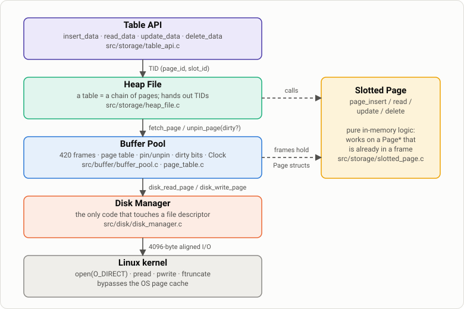
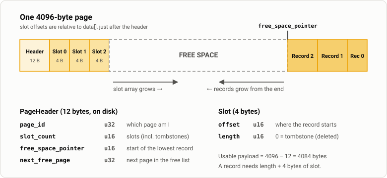
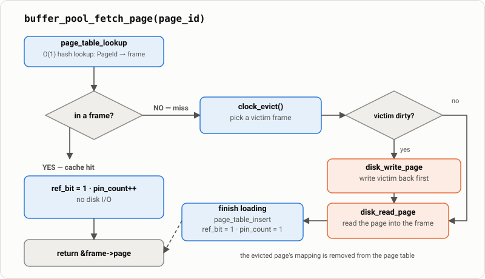
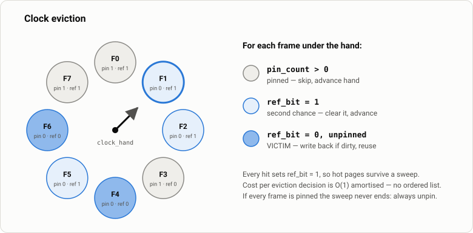
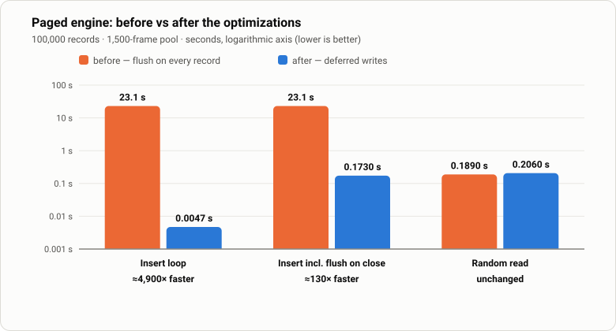
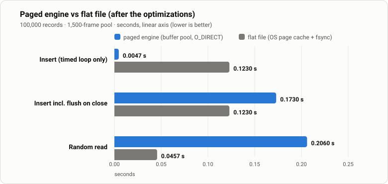
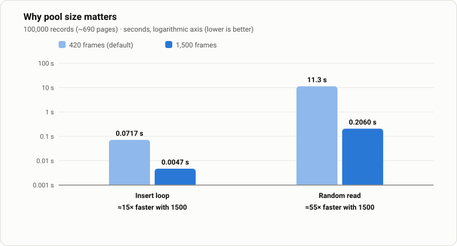
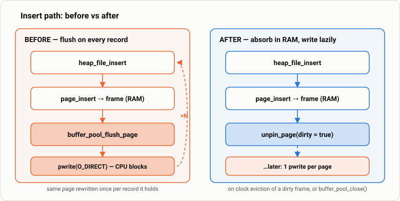

<h1 align="center">Mini Storage Engine in C</h1>

<p align="center">
  A page-based database storage engine built from scratch — slotted pages, a heap file,
  a buffer pool with Clock eviction, and direct disk I/O. No dependencies, ~1,600 lines of C.
</p>

<p align="center">
  
  
  
  
</p>

---

## Contents

1. [What this project is](#1-what-this-project-is)
2. [The aim](#2-the-aim)
3. [Architecture at a glance](#3-architecture-at-a-glance)
4. [Layer by layer](#4-layer-by-layer)
5. [TID — how a record is addressed](#5-tid--how-a-record-is-addressed)
6. [Performance: the optimizations that boosted it](#6-performance-the-optimizations-that-boosted-it)
7. [Getting started](#7-getting-started)
8. [Using the API](#8-using-the-api)
9. [Configuration](#9-configuration)
10. [Tests](#10-tests)
11. [Project layout](#11-project-layout)
12. [Known issues and limitations](#12-known-issues-and-limitations)
13. [Roadmap](#13-roadmap)

---

## 1. What this project is

Most developers meet databases through SQL. This project is the layer *underneath* SQL, the query planner and
the indexes: the code that decides **which page a record lives on, how to find it again, which pages stay in
RAM, and when bytes actually hit the disk**.

It is a small but real implementation of ideas from PostgreSQL's heap storage and InnoDB's buffer pool:

| Concept | In this project |
| --- | --- |
| Slotted pages with slot indirection | `src/storage/slotted_page.c` |
| Tuple identifiers (`page_id`, `slot_id`) | `include/common/tid.h` |
| Heap file with a free-page list | `src/storage/heap_file.c` |
| Buffer pool: pinning, dirty tracking, Clock eviction | `src/buffer/buffer_pool.c` |
| Hash-table page table (`PageId → frame`) | `src/buffer/page_table.c` |
| Direct I/O (`O_DIRECT`), 4 KiB-aligned transfers | `src/disk/disk_manager.c` |
| Variable-length records, in-place and relocating updates, tombstone deletes | `slotted_page.c`, `heap_file.c` |

It is **educational software**: single-threaded, no crash recovery, no indexes, no query language. Section
[12](#12-known-issues-and-limitations) is an honest list of what does and does not work today.

## 2. The aim

The goal is to *understand a database by building the part everybody skips*.

- **Learn by implementing.** Build every layer between `insert(bytes)` and `pwrite(fd, …)` yourself, so nothing is a black box.
- **Keep layers honest.** Each layer has one job and a small interface, so you can swap one out (e.g. Clock → LRU) without touching the rest.
- **Measure, don't guess.** The repo ships a benchmark against a plain flat file, and the optimization report below shows
  what was found by profiling it — including mistakes that turned a *buffer pool* into a *slowdown*.
- **Be a foundation.** TIDs are stable across in-page updates, which is exactly the property a B+ Tree index (the next planned
  step) needs: index leaves store `(key, TID)` and never need rewriting when a record moves inside its page.

## 3. Architecture at a glance

> **Color key — the same in every diagram and chart:**
> 🟪 Table API · 🟩 Heap File · 🟦 **Buffer Pool** (and the paged engine in benchmarks) · 🟨 Slotted Page · 🟧 Disk Manager / blocking disk I/O · ⬜ Linux kernel and the flat-file baseline

<p align="center">
  
</p>

A call travels **down** the stack; a page travels **up**. Take `read_data(tid)`:

1. **Table API** forwards to `heap_file_read`.
2. **Heap File** splits the TID into `page_id` + `slot_id` and asks the **Buffer Pool** for the page.
3. **Buffer Pool** checks its page table. On a hit it returns the frame immediately. On a miss it evicts a victim and asks the **Disk Manager** to `pread` the page into it.
4. **Heap File** hands the in-memory `Page*` to the **Slotted Page** code, which finds the slot and copies the record out.
5. **Heap File** unpins the page so it can be evicted again.

Heap File is the only layer that talks to both the Buffer Pool and the Slotted Page. The Slotted Page module never does I/O — it only reshapes a page that is already in memory.

## 4. Layer by layer

### 4.1 Table API — `src/storage/table_api.c`

The outermost layer and the only one an application should call.

```c
TableAPI *table_api_open(const char *path);
void      table_api_close(TableAPI *api);

TID  insert_data(TableAPI *api, void *data, uint16_t length);
int  read_data  (TableAPI *api, TID tid, void *out, uint16_t length);   // 1 = found, 0 = missing/deleted
TID  update_data(TableAPI *api, TID tid, void *data, uint16_t length);  // may return a *new* TID
void delete_data(TableAPI *api, TID tid);
```

It is deliberately **byte-oriented** — it takes `(void*, length)`, not a schema. `Student` in `include/data/student.h` is just the demo/benchmark record.

### 4.2 Heap File — `src/storage/heap_file.c`

Manages a *table* as a collection of pages and turns record operations into page operations.

- **Insert** walks a linked list of pages that still have room (`first_free_page` → `next_free_page` → …), puts the record in the first page that fits, and unlinks a page once less than `MIN_FREE_SPACE` bytes remain. If no page fits, it allocates a fresh one through the buffer pool and retries.
- **Read** fetches the page, calls `page_read`, unpins it clean.
- **Delete** tombstones the slot and pushes the page back onto the free list.
- **Update** tries in place; if the record no longer fits in its page it deletes and re-inserts elsewhere, returning a **new TID**.
- **Write policy:** the heap file never flushes. It unpins pages as *dirty* and lets the buffer pool decide when to write (see [§6](#6-performance-the-optimizations-that-boosted-it) — this one change is the biggest win).

### 4.3 Slotted Page — `src/storage/slotted_page.c`, `page.c`

Owns the byte layout of a single 4096-byte page. No I/O, no knowledge of files.

<p align="center">
  
</p>

- The **slot array grows forward** from the header; **record bytes grow backward** from the end. Free space is the gap in between, and `free_space_pointer` marks where the lowest record starts.
- A slot is `{offset, length}`. A record's **slot index never changes**, even if its bytes move — that is the indirection that keeps TIDs valid.
- **Delete** sets `length = 0` (a *tombstone*); the slot stays so other slot ids don't shift.
- **Update** is in place if the new record is not longer; otherwise a new copy is written at the free-space pointer and the slot is repointed; if even that doesn't fit, the heap file relocates the record to another page.
- `is_dirty`, `pin_count` and `ref_bit` are **not** in the page header. They describe *memory* state, so they live in the buffer frame — a lesson recorded in the project notes.

### 4.4 Buffer Pool — `src/buffer/`

A fixed array of page-sized **frames** that caches disk pages, so most accesses never reach the disk.

```c
Page *buffer_pool_fetch_page(BufferPool *bp, PageId id);               // pin + return
Page *buffer_pool_new_page  (BufferPool *bp, PageId *out_id);          // allocate + pin
void  buffer_pool_unpin_page(BufferPool *bp, PageId id, bool dirty);   // release
bool  buffer_pool_flush_page(BufferPool *bp, PageId id);               // explicit write-through
```

Three ideas make it work:

| Idea | Meaning |
| --- | --- |
| **Pinning** | `pin_count > 0` means a caller holds a pointer into the frame, so it must not be evicted. Every `fetch` needs a matching `unpin`. |
| **Dirty tracking** | A page modified in RAM is flagged dirty on unpin. Dirty frames are written before they are reused and when the pool closes; clean frames are simply overwritten. |
| **Clock eviction** | A cheap approximation of LRU: a circular hand with one reference bit per frame (below). |

<p align="center">
  
</p>

<p align="center">
  
</p>

**Page table** (`page_table.c`) is a chaining hash table mapping `PageId → FrameId` in O(1) average time, using a multiplicative hash (`page_id * 2654435761 % capacity`). On eviction the victim's mapping is deleted before the frame is reused.

For comparison with the real thing: InnoDB uses a midpoint-insertion LRU, a background page-cleaner thread, per-page latches and multiple pool instances. This pool has none of that — it is the single-threaded core idea only.

### 4.5 Disk Manager — `src/disk/disk_manager.c`

The only code that touches a file descriptor.

```c
DiskManager *disk_manager_open(const char *path);   // open(O_RDWR | O_CREAT | O_DIRECT)
void   disk_read_page (const DiskManager *dm, PageId id, void *buf);   // pread  4096 B @ id*4096
void   disk_write_page(DiskManager *dm, PageId id, const void *buf);   // pwrite 4096 B @ id*4096
PageId disk_allocate_page(const DiskManager *dm);                       // next id = file_size / 4096, grown with ftruncate
```

- Page *N* lives at byte offset `N × 4096` — no directory, no indirection.
- The file is opened with **`O_DIRECT`**, so the engine, not the kernel page cache, decides what is cached. That is what makes the benchmark meaningful, and it imposes strict **4 KiB alignment** rules (see [Core Issue 3](#core-issue-3--memory-alignment-and-dma-rejections)).
- Allocation extends the file with `ftruncate` instead of writing a blank page (see [Core Issue 2](#core-issue-2--double-write-on-page-allocation)).

## 5. TID — how a record is addressed

```c
typedef struct tid {
    PageId page_id;   // u32 — which 4 KiB page
    SlotId slot_id;   // u8  — which slot inside it
} TID;
```

A TID is 5 bytes of information (8 in memory after struct padding). It is the same idea as PostgreSQL's `CTID`: reading a record is **one page lookup + one array index**, with no search. Because the slot array provides indirection, a record that moves *within* its page keeps its TID. Only a cross-page relocation (an update that outgrows its page) produces a new one, and `update_data` returns it.

## 6. Performance: the optimizations that boosted it

The benchmark (`benchmark/benchmark.c`) compares the paged engine with a flat-file baseline. The first results were
disappointing — a *buffer pool* that made 100,000 inserts take **over 20 seconds**. Profiling found four independent
problems; this section documents them, and what the numbers look like once they are fixed.

> **Update — numbers re-measured.** The project's original optimization report (`notes/03-optimization_report.md`) recorded
> a ~2,066× insert and ~6.8× random-read speed-up. While re-checking them I found that the committed code was silently
> failing every direct write to the database file (an alignment bug, fixed in this change — see
> [Core Issue 3](#core-issue-3--memory-alignment-and-dma-rejections)). With writes failing, the file stayed empty, so the "fast
> random reads" were reads of empty pages. **The figures below were re-measured with correct I/O** and verified by reopening
> the database and reading back all 100,000 records.

### Results (100,000 records, 1,500-frame pool)

| Metric | Before | After | Change |
| :--- | ---: | ---: | :--- |
| **Paged insert — timed loop** | 23.1 s | **0.0047 s** | **≈4,900× faster** |
| **Paged insert — including the flush on close** | ≈23.1 s | **≈0.17 s** | **≈130× faster** |
| Paged random read | 0.19 s | 0.21 s | unchanged — these fixes target the write path |
| Flat-file insert / random read (baseline) | 0.12 s / 0.042 s | 0.12 s / 0.046 s | — |

<p align="center">
  
</p>

"Before" is the pre-optimization code (commit `e6bd6a5`) with only the alignment fix applied, so both columns do real disk I/O.
Each "after" figure is the mean of 2–3 runs; each "before" figure is a single run (it takes 23 s).

**Paged vs flat file.** The buffer pool wins decisively *inside the timed insert loop*, but that loop stops before the dirty pages are
flushed. Counting the flush, the flat file is still slightly ahead on inserts, and it is clearly ahead on random reads — the flat
file benefits from the OS page cache, while the paged engine uses `O_DIRECT` and starts every run with a cold pool.

<p align="center">
  
</p>

**Pool size is the dominant knob.** 100,000 records of 24 B occupy about 690 pages. With the committed default of 420 frames the
working set does not fit; random reads take **11.3 s** instead of **0.21 s** because most accesses miss and go to the device.

<p align="center">
  
</p>

This is the same lesson as `innodb_buffer_pool_size` in MySQL: a buffer pool only helps when it can hold the working set.

### 6.1 The four fixes

The mechanism behind the biggest win — write absorption instead of write-through:

<p align="center">
  
</p>

#### Core Issue 1 — Premature synchronous row flushes
*`src/storage/heap_file.c`, `heap_file_insert` · commits `43f4483`, `e8e3e90`*

The insert path called `buffer_pool_flush_page()` after **every** record. With `O_DIRECT`, each call is a blocking write to the device, so the buffer pool was defeated: a page holding 50 records was physically rewritten 50 times. This is *write amplification*, and it destroys the whole point of a buffer pool — **write absorption**.

```c
SlotId slot_id = page_insert(page, data, length);
buffer_pool_flush_page(hf->buffer_pool, page->header.page_id);   // ← flaw: forced write per record
```

**Fix:** remove the flush. The page is unpinned as dirty; the write is deferred until `clock_evict()` reclaims the frame or `buffer_pool_close()` runs.

```c
buffer_pool_unpin_page(hf->buffer_pool, page->header.page_id, true);
```

This is the source of the insert speed-up (≈4,900× on the timed loop): inserts now run at `memcpy` speed in RAM until a frame is evicted.

#### Core Issue 2 — Double write on page allocation
*`src/disk/disk_manager.c`, `disk_allocate_page` · commit `4b6a7ff`*

Allocating a page first `pwrite`-ed a blank page to disk to reserve space, and then the buffer pool loaded it into a frame, dirtied it, and wrote it *again* later. Two physical writes for one new page.

```c
page_init(&page, newPageId);
pwrite(fd, &page, PAGE_SIZE, (off_t)newPageId * PAGE_SIZE);      // ← redundant physical write
```

**Fix:** extend the file with `ftruncate()`. It only updates metadata (a sparse extension) and issues no data write; the page's first real write happens once, at eviction or close.

```c
ftruncate(fd, (off_t)(newPageId + 1) * PAGE_SIZE);
```

#### Core Issue 3 — Memory alignment and DMA rejections
*`src/buffer/buffer_pool.c`, `include/buffer/buffer_frame.h` · commits `0de6e0d`, `c2eaa25`, plus the follow-up fix below*

To compare fairly against a flat file, the engine opens its file with `O_DIRECT`, bypassing the kernel page cache. Direct I/O hands buffers straight to the device via DMA, so the kernel requires the user buffer to be **aligned to the sector boundary (4096 B)**. `malloc` makes no such promise: `pread`/`pwrite` failed with `EINVAL`, the errors went unchecked, and the engine then parsed garbage pages and segfaulted.

**First fix:** allocate the pool with `posix_memalign`:

```c
BufferPool *bp = NULL;
int ret = posix_memalign((void **)&bp, 4096, sizeof(BufferPool));
```

**Follow-up fix (this is what made I/O actually correct).** Aligning the *start* of the pool is not enough: a `BufferFrame` was 4108 bytes (a 4096-byte page plus metadata), so every frame after the first held a page at a misaligned address, and `fetch_page` read into an unaligned stack buffer. Those `pwrite`/`pread` calls still failed with `EINVAL` — silently. The visible symptom was an engine that looked extremely fast because it wrote and read nothing. Each frame's page is now individually aligned, and `fetch_page` reads directly into the frame:

```c
struct buffer_frame {
    _Alignas(4096) Page page;   // every frame's page starts on a 4 KiB boundary
    ...
};
```

(`sizeof(BufferFrame)` is now 8192, so a frame costs 8 KiB of RAM instead of 4 KiB.)

#### Core Issue 4 — Benchmark harness: stack overflow and the wrong clock
*`benchmark/benchmark.c` · commit `e6bd6a5`*

- **Stack overflow.** `TID tids[N]; int ids[N];` lived on the stack. At 500 k–1 M records that is 14–18 MB, over Linux's default 8 MB `ulimit -s`, so the benchmark crashed before running a single operation. **Fix:** allocate on the heap with `malloc`.
- **Wrong timer.** `clock()` measures *CPU time*. When a process blocks on disk I/O it is asleep and `clock()` stops ticking — so the slow, I/O-bound "before" code looked fast. **Fix:** use wall-clock `clock_gettime(CLOCK_MONOTONIC)`.

```c
double now(void) {
    struct timespec ts;
    clock_gettime(CLOCK_MONOTONIC, &ts);
    return (double)ts.tv_sec + (double)ts.tv_nsec / 1e9;
}
```

The flat-file baseline was reworked in the same harness pass (wall-clock timing, it now serializes the name string, and it `fsync`s inside the timed region), so its before/after numbers are not an engine improvement. They are listed only for completeness.

### 6.2 How to read the numbers

- **Machine:** one Linux box (Ubuntu 24.04, ext4, `gcc -O0` via the provided scripts). Absolute numbers depend heavily on the storage device — the size of the 23 s "before" figure in particular. The *direction* and the cause (a blocking direct write per record) are not machine-specific.
- **Timed loop vs end-to-end.** `benchmark.c` stops the paged-insert clock before `table_api_close()`. With a pool that holds the dataset, nearly all the write cost lands in that close (~0.17 s here). Both are shown above; end-to-end is the fairer comparison with the flat file, which `fsync`s inside its timer.
- **What is stored.** The paged benchmark stores the raw 24-byte `Student` struct, whose `char *name` is a *pointer*, not the string. The flat-file baseline writes the name bytes too, so the paged side moves less data per record.
- **Cold reads.** Random reads start from an empty pool and `O_DIRECT` bypasses the OS cache, so the first touch of every page is a real device read.
- **Original report.** The numbers in the optimization report (9.35 s → 0.0045 s insert, 0.046 s → 0.0067 s read) were produced by the unaligned-I/O build described above. The insert result is directionally right; the read result was not a real measurement.

## 7. Getting started

**Requirements:** Linux, a C11 compiler (`gcc` or `clang`), and a filesystem that supports `O_DIRECT` (ext4, XFS, Btrfs…; some `tmpfs` setups do not). There are no libraries to install.

The scripts in `scripts/` compile with `gcc` and run — they are the supported way to build:

```bash
./scripts/run_main.sh        # run the demo (CRUD walkthrough, writes ./database.db)
./scripts/run_test.sh        # run the regression suite
./scripts/run_benchmark.sh   # paged engine vs flat file
```

Binaries land in `executables/`; runtime database files land in `databases/` (both git-ignored). To compile by hand:

```bash
gcc -std=c11 -Wall -Wextra \
    src/logging/logger.c src/disk/disk_manager.c src/buffer/page_table.c \
    src/buffer/buffer_pool.c src/storage/slotted_page.c src/storage/heap_file.c \
    src/storage/table_api.c src/storage/page.c \
    main.c -o main_exec && ./main_exec
```

> The benchmark's dataset size is `NUMBER_OF_STUDENTS` at the top of `benchmark/benchmark.c`. Run it from the repo root (the scripts do) so `./databases/` resolves.

## 8. Using the API

```c
#include "include/storage/table_api.h"

typedef struct { int id; char name[32]; } Row;      // any fixed-size, pointer-free record

TableAPI *db = table_api_open("databases/my.db");

Row r = { .id = 1, .name = "Asha" };
TID tid = insert_data(db, &r, sizeof r);            // returns the record's address

Row out;
if (read_data(db, tid, &out, sizeof out)) { /* found */ }

Row r2 = { .id = 1, .name = "Asha K." };
tid = update_data(db, tid, &r2, sizeof r2);         // always keep the returned TID

delete_data(db, tid);                               // tombstone; read_data now returns 0

table_api_close(db);                                // flushes every dirty page
```

Always call `table_api_close` — it is what writes dirty pages that were never evicted.

## 9. Configuration

Compile-time constants in [`include/common/config.h`](include/common/config.h):

| Constant | Default | Meaning |
| --- | --- | --- |
| `PAGE_SIZE` | `4096` | Page and disk-block size. Must match the `O_DIRECT` alignment. |
| `BUFFER_POOL_SIZE` | `420` | Number of frames (8 KiB of RAM each). Raise it until your working set fits — see [§6](#6-performance-the-optimizations-that-boosted-it). |
| `PAGE_TABLE_CAPACITY` | `BUFFER_POOL_SIZE` | Hash buckets in the page table. |
| `ENABLE_LOGGING` | `0` | Set to `1` for a trace of every layer call (very verbose). |
| `DATABASE_FILE_PATH` | `"database.db"` | Default file for the demo. |

## 10. Tests

| Suite | File | What it checks |
| --- | --- | --- |
| Regression | `tests/test.c` (`./scripts/run_test.sh`) | **TID stability** (deleted TIDs stay invalid, new inserts get distinct TIDs), **updates** (in place and relocating), **bulk records** (mixed insert/delete/update/re-insert, every live record verified, every dead TID verified invalid). |
| Buffer pool | `tests/buffer_pool_test.c` | New page + pinning, cache miss, cache hit re-pins, pin counts, dirty pages and flush, Clock eviction, dirty-page eviction, unpin/flush of a missing page. |
| Demo | `main.c` | A 10-record CRUD walkthrough with assertions. |

Compile the buffer-pool suite by hand (it is not wrapped in a script on `master`):

```bash
mkdir -p databases && gcc -std=c11 -Wall -Wextra \
    src/logging/logger.c src/disk/disk_manager.c src/buffer/page_table.c \
    src/buffer/buffer_pool.c src/storage/slotted_page.c src/storage/heap_file.c \
    src/storage/table_api.c src/storage/page.c \
    tests/buffer_pool_test.c -o buffer_pool_test && ./buffer_pool_test
```

## 11. Project layout

```
storage-engine/
├── include/
│   ├── buffer/     buffer_pool.h  buffer_frame.h  page_table.h  page_table_node.h
│   ├── common/     config.h  tid.h
│   ├── data/       student.h              (demo record)
│   ├── disk/       disk_manager.h
│   ├── logging/    logger.h
│   └── storage/    page.h  slot.h  slotted_page.h  heap_file.h  table_api.h
├── src/
│   ├── buffer/     buffer_pool.c  page_table.c
│   ├── disk/       disk_manager.c
│   ├── logging/    logger.c
│   └── storage/    page.c  slotted_page.c  heap_file.c  table_api.c
├── benchmark/      benchmark.c            (paged engine vs flat file)
├── tests/          test.c  buffer_pool_test.c
├── scripts/        run_main.sh  run_test.sh  run_benchmark.sh
├── docs/images/    SVG diagrams and charts used by this README
├── main.c          demo
└── CMakeLists.txt
```

## 12. Known issues and limitations

Honesty section — these are real, found while documenting the project.

**Correctness / robustness**

- **I/O errors are not propagated.** `disk_read_page` / `disk_write_page` only log failures (and only when logging is on), and `disk_manager_open` doesn't abort on a failed `open()`. This is how the alignment bug in [Core Issue 3](#core-issue-3--memory-alignment-and-dma-rejections) went unnoticed: writes were failing and nothing reported it. Next step: make these functions return a status and check it.
- **Free-space checks disagree.** `heap_file_insert` tests `free_space >= length`, but `page_insert` needs `length + sizeof(Slot)`. For some record sizes the insert returns slot `0xFF` and the record is not stored. Reproduced for 10 of the 193 record lengths tried (8–200 B). Related: `SlotId` is 8-bit (max 255 slots per page, `0xFF` reserved) and `get_free_space` counts the page header twice (12 B understated).
- **The free-page list is not rebuilt on open.** `heap_file_open` resets `first_free_page`; reopening an existing database keeps old records readable by TID, but new inserts start on new pages and don't refill old gaps.
- **Page ids are ambiguous near 65 535.** `INVALID_PAGE_ID` is `UINT16_MAX` while `PageId` is 32-bit, so a real page 65 535 (~256 MiB into the file) collides with the sentinel.
- **No space reclamation.** Growing an in-page update leaves the old bytes behind, and there is no page compaction.
- **Pinned frames can hang eviction.** If every frame is pinned, `clock_evict` loops forever instead of returning an error. Always pair `fetch` with `unpin`.

**Scope**

- Single-threaded: no latches, no locks. Synchronous flushing only — there is no background page cleaner.
- No crash recovery or durability guarantees: no write-ahead log, and `lsn` is not implemented.
- No indexes and no query layer.

**Build**

- The `CMake` target builds the demo (`main.c`) only; it has not been exercised with a real CMake install in this environment, so the `scripts/` and `gcc` commands above remain the verified way to build.

## 13. Roadmap

- [ ] Propagate and check I/O errors; fix the free-space check mismatch (see §12)
- [ ] Benchmark across pool sizes and add a sequential-scan workload
- [ ] Shrink `BufferFrame` back to 4 KiB by moving per-frame metadata out of the aligned region
- [ ] B+ Tree index storing `(key, TID)` pairs — TID stability makes this cheap to maintain
- [ ] Write-ahead logging and crash recovery (`lsn` in the page header)
- [ ] LRU / LRU-K as a configurable alternative to Clock
- [ ] Background flushing (a page cleaner) and basic concurrency (page latches)
- [ ] Persist and rebuild the heap file's free-page list; page compaction
- [ ] Free-space allocation strategies (first / best / worst / next fit)
- [ ] A small query layer on top
